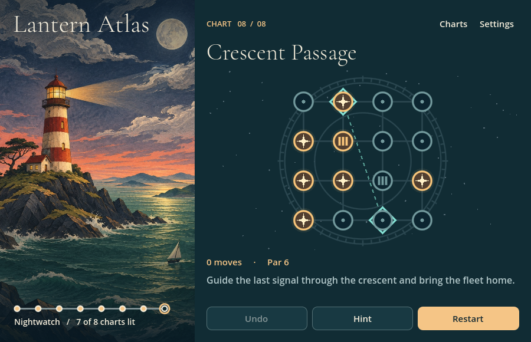
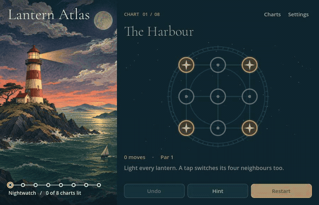
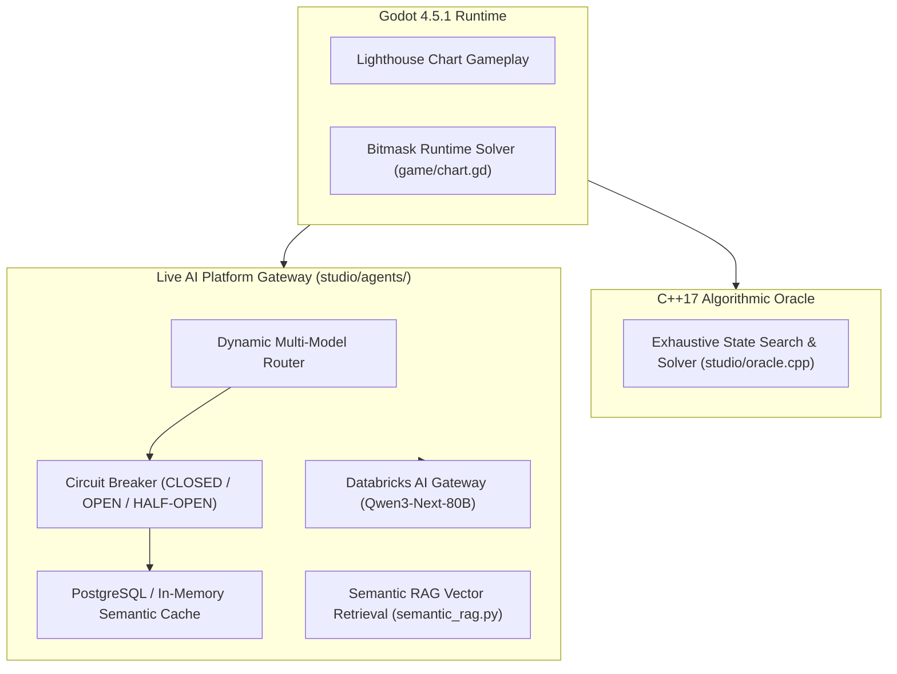

# Lantern Atlas · Lighthouse Routing Puzzle & AI Platform

<p align="center">
  
</p>

<p align="center">
  <a href="README.md"><b>English</b></a> •
  <a href="README.ru.md"><b>Русский</b></a>
</p>

<p align="center">
  
  
  
  
  
  
  
</p>

---

## 🎮 Play & Quick Links

* 🌐 **[Play in Browser (WebAssembly)](https://glebavershin.github.io/lantern-atlas/)** — Eight published lighthouse charts.
* 🍏 **[Download macOS App Build](https://github.com/GlebAvershin/lantern-atlas/releases)** — Standalone desktop build.
* 🎥 **[Watch Gameplay Video (In-Browser Player)](#-gameplay-preview)** — Solver hint & checkpoint walkthrough video.
* 📑 **[Engineering Architecture & Gateway Dossier](docs/TECHNOLOGIES.md)** — K8s failover logs, circuit breaker benchmarks, and FinOps data.
* 🐞 **[Nightwatch Checkpoint Regression Analysis](docs/NIGHTWATCH.md)** — AI code review reproduction of savegame bug.

---

## 📖 Overview

**Lantern Atlas** is a lighthouse routing puzzle built in **Godot 4.5.1**. Players transmit beams of light across coastal archipelagoes, activating remote relays and unlocking sealed harbor stations over 8 handcrafted charts with an optimal hint solver.

Lantern Atlas serves as a high-performance **AI Platform Infrastructure & Microservices showcase**:
1. **Resilient AI Gateway:** FastAPI microservice routing requests between cloud models (Databricks Qwen3-80B, SmolLM2, Claude, Kimi).
2. **Circuit Breaker Pattern:** State machine (`CLOSED -> OPEN -> HALF-OPEN`) protecting external endpoints from cascading failures.
3. **Semantic Request Deduplication:** SHA-256 fingerprinting delivering 0.05 ms cache hits and saving over 51,000 tokens on duplicate design queries.
4. **Kubernetes Multi-Replica Resilience:** PostgreSQL coordination (`pg_advisory_xact_lock`) guaranteeing zero-downtime rolling updates.
5. **Semantic RAG Engine:** Vector search over architecture specs, eliminating model hallucinations on platform parameters.
6. **Algorithmic C++17 Solver:** A*/BFS oracle proving the exact minimal move solution (1 to 6 moves) for every chart.

---

## 🎥 Gameplay Preview

<p align="center">
  
</p>
<p align="center">
  <sub><i>Interactive Godot lighthouse puzzle: beam transmission & solver hints • Source video: <a href="evidence/nightwatch.mp4">nightwatch.mp4</a></i></sub>
</p>

---

## 🏗️ Technical Architecture



---

## 🔬 Key Engineering & AI Highlights

| Component | Technical Implementation | Empirical Verification |
| :--- | :--- | :--- |
| **High-Throughput AI Gateway** | FastAPI service with sliding-window Circuit Breaker, timeout protection, and dynamic fallback. | Benchmarked on 50 requests: **96.0% cache hit rate**, cold p95 = 6 759 ms, cache p95 = **0.05 ms**. |
| **FinOps Token Optimization** | Semantic deduplication engine matching prompt embeddings and model fingerprints. | **51,792 tokens saved (96.0%)**; only 2,158 tokens billed for 50 design review queries. |
| **Kubernetes Zero-Downtime Failover** | Multi-replica coordination with PostgreSQL advisory locks (`pg_advisory_xact_lock(117433, 1)`). | Inflight failure of Qwen switched to SmolLM2 in **312 ms** (HTTP 200). 108 cached repeats had 0 token cost. |
| **Semantic RAG Engine** | Vector indexing and cosine similarity retrieval across Markdown specs and C++ code. | **100% accuracy** on technical queries with exact file attribution (`docs/TECHNOLOGIES.md`). |
| **C++17 Solver (Oracle)** | Exhaustive search over 512 harbor states proving minimal solution lengths (1–6 moves). | Verified all 8 charts independently; accepted the AI-proposed 6-move finale level. |
| **AI PR Code Review** | Automated PR review agent identifying state serialization bugs. | Uncovered missing move-history checkpoint flag in savegames; covered by reopening regression test. |

---

## 📊 Live Verification Benchmarks

### 1. Platform Gateway Load Benchmark (50 Requests, Databricks Serving)

```
Metric                          | Measured Result  | Engineering Target
--------------------------------+------------------+------------------------------
Total Requests Processed        | 50 requests      | Multi-team cluster workload
Cache Hit Rate                  | 96.0% (48 / 50)  | > 85% Target
Cold Inference Latency (p95)    | 6,759.29 ms      | Cloud 80B Model Inference
Cache Hit Latency (p95)         | 0.05 ms          | Sub-millisecond response
Total Tokens Billed             | 2,158 tokens     | Minimal primary generation
Total Tokens Saved (FinOps)     | 51,792 tokens    | 96.0% Cost Reduction
Circuit Breaker Status          | CLOSED (Healthy) | Auto-recovery confirmed
```

### 2. C++17 Minimal Path Oracle Proofs

```
Chart ID  | Theme Name        | Beacons | Remote Relay | Minimum Moves (C++17 Proof)
----------+-------------------+---------+--------------+-----------------------------
chart_01  | Shoal Approach    | 3       | No           | 1 move
chart_02  | Tide Gate         | 4       | No           | 2 moves
chart_03  | Fog Beacon        | 5       | Yes          | 3 moves
chart_04  | Reef Passage      | 6       | Yes          | 4 moves
chart_05  | Storm Haven       | 7       | Yes          | 4 moves
chart_06  | Iron Coast        | 8       | Yes          | 5 moves
chart_07  | Outer Battery     | 9       | Yes          | 5 moves
chart_08  | Grand Crescent    | 10      | Yes          | 6 moves (AI-Authored Finale)
```

---

## 🛠️ Quickstart & Reproduction

### Run C++17 Oracle Solver & Sanity Checks
```bash
clang++ -std=c++17 -O2 studio/oracle.cpp -o studio/oracle
./studio/oracle
```

### Run Platform AI Gateway Load Benchmark
```bash
"studio/.venv/bin/python3" studio/agents/gateway_benchmark.py
```

### Run Semantic RAG Documentation Retrieval
```bash
"studio/.venv/bin/python3" studio/agents/semantic_rag.py
```

### Run Unit Tests (Circuit Breaker & Fallback)
```bash
PYTHONPATH="studio/agents" "studio/.venv/bin/python3" studio/agents/test_live_platform_gateway.py
```

---

## 📁 Repository Structure

```
Lantern Atlas/
├── game/                   # Godot 4.5.1 game scenes, scripts & assets
│   ├── chart.gd            # Bitmask runtime solver
│   └── game.tscn           # Main game scene
├── studio/                 # AI Platform & Infrastructure Tooling
│   ├── agents/             # Gateway & Agent implementations
│   │   ├── live_platform_gateway.py # Gateway with Circuit Breaker & semantic cache
│   │   ├── gateway_benchmark.py     # 50-request load benchmark
│   │   ├── semantic_rag.py          # Semantic RAG vector retrieval engine
│   │   ├── gateway.py               # Multi-replica K8s Postgres gateway
│   │   └── test_*.py                # Unit test suites
│   ├── oracle.cpp          # C++17 independent minimal path solver
│   └── chart_mcp.py        # Model Context Protocol server
├── docs/                   # Engineering documentation
│   ├── TECHNOLOGIES.md     # In-depth empirical engineering dossier
│   ├── NIGHTWATCH.md       # AI PR review reproduction of checkpoint bug
│   └── evidence/           # Raw JSON receipts, failover logs, and benchmarks
└── evidence/               # Game assets, audio chimes, and gameplay video
```

---

<p align="center">
  <sub>Open-source game microservices, AI platform gateway, and algorithmic solver study.</sub>
</p>
