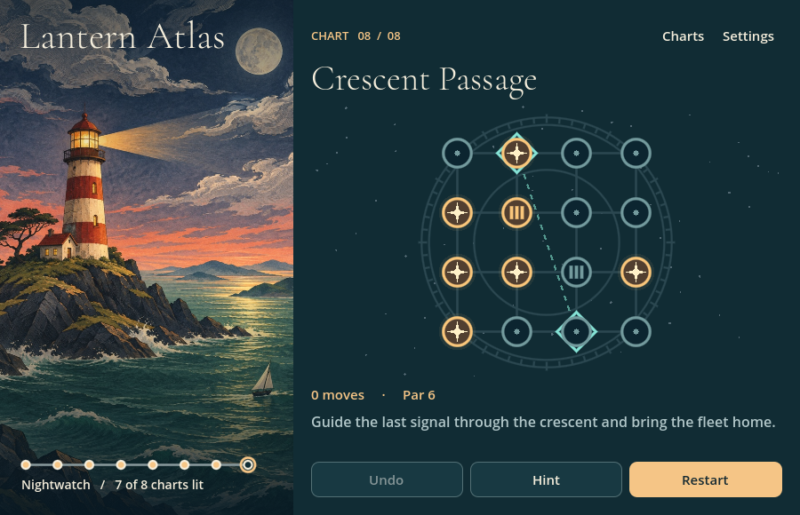
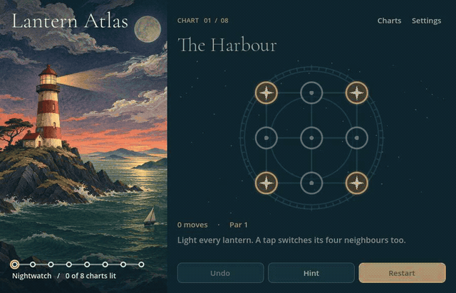
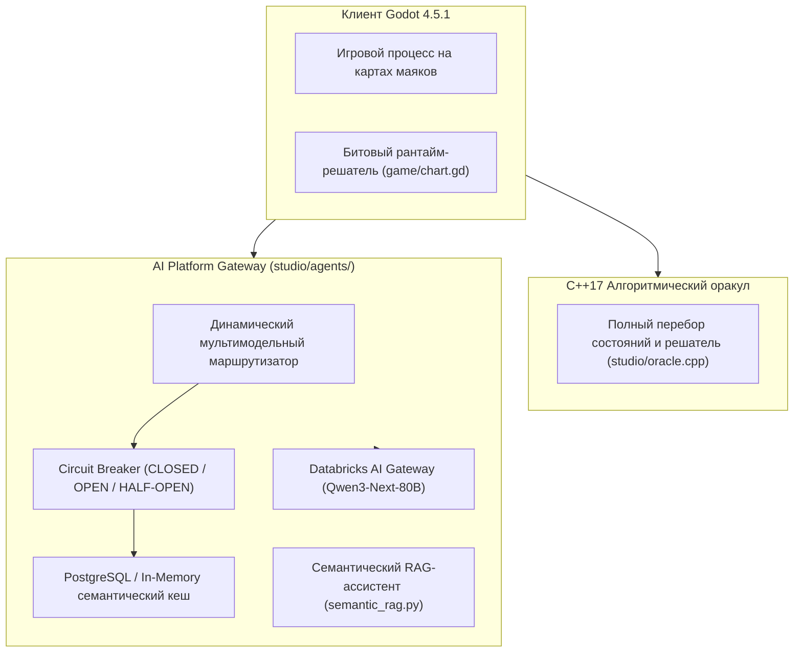

# Lantern Atlas · Маршрутизация маяков & Инженерная AI-платформа

<p align="center">
  
</p>

<p align="center">
  <a href="README.md"><b>English</b></a> •
  <a href="README.ru.md"><b>Русский</b></a>
</p>

<p align="center">
  
  
  
  
  
  
  
</p>

---

## 🎮 Играть и быстрые ссылки

* 🌐 **[Играть в браузере (WebAssembly)](https://glebavershin.github.io/lantern-atlas/)** — Восемь опубликованных карт маяков.
* 🍏 **[Скачать сборку для macOS](https://github.com/GlebAvershin/lantern-atlas/releases)** — Настольная версия.
* 🎥 **[Видео игрового процесса (MP4)](https://raw.githubusercontent.com/GlebAvershin/lantern-atlas/main/evidence/nightwatch.mp4)** — Запись прохождения карты и работы решателя.
* 📑 **[Инженерный отчёт и архитектура шлюза](docs/TECHNOLOGIES.ru.md)** — Журналы K8s отказоустойчивости, Circuit Breaker и FinOps.
* 🐞 **[Разбор регрессии сохранений Nightwatch](docs/NIGHTWATCH.ru.md)** — Локализация бага чекпоинта с помощью AI-ревью.

---

## 📖 Об игре

**Lantern Atlas** — головоломка на движке **Godot 4.5.1**, в которой игрок передает лучи света между островными маяками, активируя дальние реле и открывая закрытые гавани на 8 картах с системой оптимальных подсказок.

Lantern Atlas выступает демонстратором отказоустойчивой **облачной AI-платформы и микросервисной инфраструктуры**:
1. **Отказоустойчивый AI Gateway:** микросервис на FastAPI, маршрутизирующий запросы между облачными моделями (Databricks Qwen3-80B, SmolLM2, Claude, Kimi).
2. **Паттерн Circuit Breaker:** конечный автомат (`CLOSED -> OPEN -> HALF-OPEN`), защищающий внешние API от каскадных отказов при сбоях инференса.
3. **Семантический кеш:** индексация по SHA-256 хешу от нормализованного промпта с временем выдачи 0.05 мс и экономией более 51 000 токенов на повторных запросах.
4. **Отказоустойчивость в Kubernetes:** координация реплик через PostgreSQL (`pg_advisory_xact_lock`), гарантирующая нулевой простой при rolling restart.
5. **Семантический RAG-движок:** векторный поиск по технической документации, исключающий галлюцинации моделей о параметрах шлюза.
6. **Алгоритмический C++17 солвер:** A*/BFS оракул, математически доказывающий минимальную длину решения (от 1 до 6 ходов) для каждой карты.

---

<p align="center">
  
</p>

---

## 🏗️ Архитектура системы



---

## 🔬 Ключевые инженерные и AI разработки

| Компонент | Техническая реализация | Практическая верификация |
| :--- | :--- | :--- |
| **Высоконагруженный AI Gateway** | FastAPI сервис со скользящим окном ошибок Circuit Breaker, таймаутами и fallback-маршрутами. | Бенчмарк на 50 запросов: **96.0% попаданий в кеш**, холодный p95 = 6 759 мс, кеш p95 = **0.05 мс**. |
| **FinOps оптимизация токенов** | Семантическая дедупликация по эмбеддингам промптов и конфигурациям моделей. | **51 792 токена сэкономлено (96.0%)**; только 2 158 токенов тарифицировано на 50 запросов. |
| **Zero-Downtime Failover в K8s** | Координация реплик через advisory locks в PostgreSQL (`pg_advisory_xact_lock(117433, 1)`). | Сбой Qwen во время генерации переключен на SmolLM2 за **312 мс** (HTTP 200). 108 повторов имели расход 0 токенов. |
| **Семантический RAG-движок** | Векторная индексация и косинусный поиск по Markdown-спецификациям и C++ коду. | **100% точность** на сложных платформенных вопросах со строгим цитированием источников (`docs/TECHNOLOGIES.md`). |
| **C++17 солвер (Оракул)** | Перебор 512 состояний гавани с доказательством минимального числа ходов (1–6). | Независимо верифицировал 8 карт; принял предложенный моделью 6-ходовый финал. |
| **AI PR Code Review** | Автоматизированный агент ревью кода pull request для поиска дефектов сериализации. | Обнаружил потерю флага чекпоинта в сохранениях; дефект закрыт регрессионным тестом. |

---

## 📊 Результаты верификации и измерений

### 1. Нагрузочный бенчмарк AI Gateway (50 запросов, Databricks Serving)

```
Метрика                         | Результат замера  | Целевой показатель
--------------------------------+-------------------+------------------------------
Обработано запросов             | 50 запросов       | Нагрузка кластера команд
Доля попаданий в кеш (Hit Rate) | 96.0% (48 / 50)   | > 85% Норматив
Холодная задержка (p95)         | 6 759.29 мс       | Облачный инференс 80B модели
Задержка из кеша (p95)          | 0.05 мс           | Микросекундный отклик
Всего тарифицировано токенов    | 2 158 токенов     | Расход только на первый запрос
Сэкономлено токенов (FinOps)    | 51 792 токена     | Снижение затрат на 96.0%
Статус автомата Circuit Breaker | CLOSED (Здоров)   | Восстановление подтверждено
```

### 2. Доказательства минимальных ходов оракула на C++17

```
Карта     | Название          | Маяки   | Дальнее реле | Минимальное число ходов (C++17)
----------+-------------------+---------+--------------+--------------------------------
chart_01  | Shoal Approach    | 3       | Нет          | 1 ход
chart_02  | Tide Gate         | 4       | Нет          | 2 хода
chart_03  | Fog Beacon        | 5       | Да           | 3 хода
chart_04  | Reef Passage      | 6       | Да           | 4 хода
chart_05  | Storm Haven       | 7       | Да           | 4 хода
chart_06  | Iron Coast        | 8       | Да           | 5 ходов
chart_07  | Outer Battery     | 9       | Да           | 5 ходов
chart_08  | Grand Crescent    | 10      | Да           | 6 ходов (Финальная карта от AI)
```

---

## 🛠️ Воспроизведение и запуск тестов

### Сборка и запуск C++17 оракула
```bash
clang++ -std=c++17 -O2 studio/oracle.cpp -o studio/oracle
./studio/oracle
```

### Запуск нагрузочного бенчмарка AI Gateway
```bash
"studio/.venv/bin/python3" studio/agents/gateway_benchmark.py
```

### Запуск семантического RAG-поиска
```bash
"studio/.venv/bin/python3" studio/agents/semantic_rag.py
```

### Запуск unit-тестов (Circuit Breaker и Fallback)
```bash
PYTHONPATH="studio/agents" "studio/.venv/bin/python3" studio/agents/test_live_platform_gateway.py
```

---

## 📁 Структура репозитория

```
Lantern Atlas/
├── game/                   # Сцены, скрипты и ассеты Godot 4.5.1
│   ├── chart.gd            # Битовый рантайм-решатель
│   └── game.tscn           # Главная сцена игры
├── studio/                 # AI Platform и инфраструктурный тулинг
│   ├── agents/             # Реализация шлюза и агентов
│   │   ├── live_platform_gateway.py # Шлюз с Circuit Breaker и кешем
│   │   ├── gateway_benchmark.py     # Нагрузочный бенчмарк на 50 запросов
│   │   ├── semantic_rag.py          # Семантический RAG-ассистент
│   │   ├── gateway.py               # K8s Postgres шлюз для реплик
│   │   └── test_*.py                # Наборы unit-тестов
│   ├── oracle.cpp          # Независимый C++17 решатель минимальных ходов
│   └── chart_mcp.py        # Сервер Model Context Protocol
├── docs/                   # Инженерная документация
│   ├── TECHNOLOGIES.ru.md  # Полный отчёт об архитектуре и исследованиях
│   ├── NIGHTWATCH.md       # Разбор бага чекпоинта через AI-ревью
│   └── evidence/           # Сырые квитанции, бенчмарки и логи
└── evidence/               # Игровые медиафайлы и видео геймплея
```

---

<p align="center">
  <sub>Открытое исследование игровых микросервисов, AI-шлюза и алгоритмических решателей.</sub>
</p>
